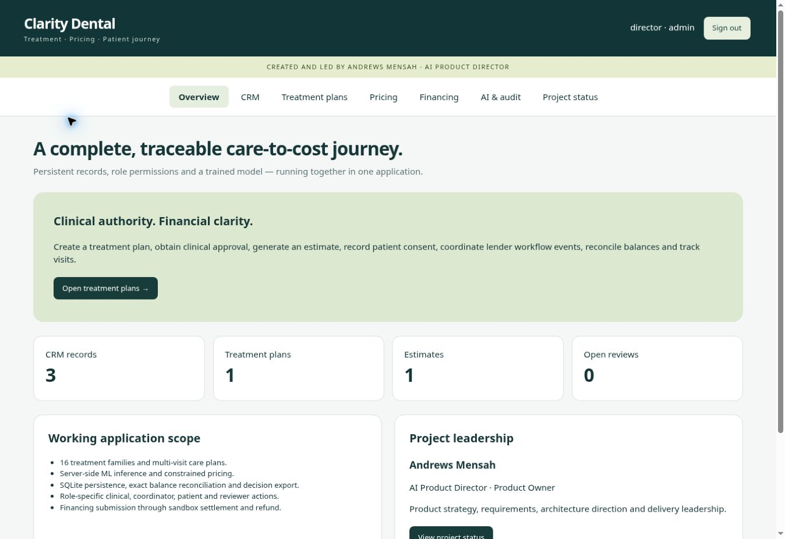

# Clarity Dental

### Created and led by Andrews Mensah

**AI Product Director · Product Owner · Architecture and Delivery Lead**

Clarity Dental brings treatment planning, AI-driven pricing, CRM, patient consent, financing workflows and financial reconciliation into one integrated application.

Andrews defined the product vision and requirements, directed the architecture and implementation decisions, established delivery priorities, and led iterative reviews of the application, models, tests and documentation. See [leadership and contributions](CONTRIBUTIONS.md).

## Platform capabilities

| Workspace | Capabilities |
|---|---|
| CRM | Patient references, contact consent and scoped access |
| Treatment plans | 16 treatment families, clinical approval, scheduling, visit completion and cancellation |
| AI pricing | Trained cost estimation, uncertainty intervals, constrained optimization and exact financial calculations |
| Patient journey | Itemized estimates, separate consents, acceptance and decision exports |
| Financing | Application, offer, acceptance, funding, decline, withdrawal and refund workflows |
| Financial operations | Deposits, payment entries, funding reconciliation and outstanding balances |
| Governance | Role permissions, version checks, idempotency and persistent audit evidence |
| Operations | Health checks, database persistence, backup and recovery tooling |

## Run the application

Requires Node.js 24+.

```bash
git clone https://github.com/anmensah44-spec/dental-pricing-ai-prototype.git
cd dental-pricing-ai-prototype
npm start
```

Open http://127.0.0.1:4173/. Select coordinator, dentist, reviewer, director or patient and choose **Open sample workspace**. The default project-account password is `Clarity-Demo-2026!`. The patient account is assigned to Demo patient 001. Records persist in SQLite across browser refresh and server restart.

## Explore the workflow

1. Coordinator creates a treatment plan.
2. Dentist reviews and approves it.
3. Coordinator evaluates pricing and records estimate acceptance.
4. Patient or coordinator records separate financing consent.
5. Director exercises the sandbox provider workflow; patient records offer consent.
6. Pricing reconciles deposits, payment entries and funding events.
7. Coordinator schedules visits; dentist completes them.
8. Director or reviewer inspects audit evidence.

[Open the walkthrough](demo/WALKTHROUGH.md).



## Validate the project

```bash
npm test
python3 -m venv .venv
source .venv/bin/activate
pip install -r scripts/requirements.txt
npm run evidence
```

The validation record contains 36 passing checks, pricing matrices, HTTP workflow tests, concurrent-retry checks, model reproduction, browser review and GitHub CI results. See [executed evidence](evidence/VALIDATION.md).

## Project documentation

- [Product charter and business case](docs/product/CHARTER.md)
- [Strategy and roadmap](docs/product/STRATEGY_ROADMAP.md)
- [Leadership case study](docs/product/CASE_STUDY.md)
- [Solution architecture](docs/architecture/SOLUTION.md)
- [API contracts](docs/architecture/API_DESIGN.md)
- [Requirements traceability](docs/requirements/TRACEABILITY.md)
- [Model methodology](docs/governance/MODEL_CARD.md)
- [Operations and recovery](docs/OPERATIONS.md)
- [Project status, data provenance and integration environment](docs/PROJECT_STATUS.md)

The repository is public and can be shared with recruiters and technical reviewers. GitHub hosts the source; the application runs on its Node backend. The Project status page records the evaluation-data setup, sandbox connections and external integration requirements in one place.
