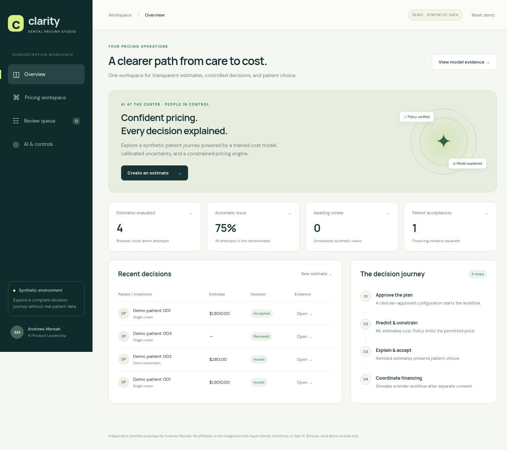

# Clarity Dental Pricing AI

An AI Product Director portfolio by **Andrews Mensah**: a runnable dental pricing prototype with trained cost estimation, constrained price selection, exact financial arithmetic, review routing, and a financing workflow simulator.

**Independent, AI-assisted portfolio project. Synthetic data only.** Aspen Dental was a reference organization in the design discussion; this repository does not establish a client engagement, endorsement, production deployment, or an integration with Aspen Dental, Synchrony Bank, or Zest AI.



## Inspect in five minutes

1. Read the [leadership case study](docs/product/CASE_STUDY.md) and [contribution statement](CONTRIBUTIONS.md).
2. Follow the [demo walkthrough](demo/WALKTHROUGH.md).
3. Inspect [pricing code](dist/engine.mjs), [training code](scripts/train_model.py), and [evaluation evidence](evidence/evaluation.json).
4. Review [architecture](docs/architecture/SOLUTION.md), [requirements traceability](docs/requirements/TRACEABILITY.md), and [production gaps](docs/governance/READINESS.md).
5. Run the commands below and compare your results with the [validation record](evidence/VALIDATION.md).

## Run locally

Requires Node.js 22+ and Python 3.11+. No browser application dependencies or API keys.

```bash
npm test
npm start
```

Open http://localhost:4173. Stop the server with Ctrl+C. Use fictional scenarios only; decisions are stored in browser localStorage. Clear browser site data to reset.

To reproduce the ML artifact in an isolated environment:

```bash
python3 -m venv .venv
source .venv/bin/activate
pip install -r scripts/requirements.txt
python scripts/train_model.py
python scripts/check_reproducibility.py
```

## What works

| Capability | Implementation |
|---|---|
| Cost estimation | Ridge regression trained on 900 generated rows; 250 calibration and 250 test rows |
| Price stability | Searches allowed cent values within a synthetic ±5% self-pay range |
| Financial controls | Integer cents, half-up basis points, margin constraints, bounded discounts |
| Benefits estimate | Fixed fictional contract, deductible and payer-cap arithmetic |
| Review routing | Missing clinical approval, stale benefits, unsupported inputs, infeasible price |
| User journey | Saved decisions, reopening, acceptance, expiry check, JSON export |
| Financing | Explicitly simulated pending, offer, decline and withdrawal states |
| Evidence | Automated engine tests, synthetic evaluation, data checksum, CI configuration |

AI estimates uncertain costs. A deterministic optimizer and exact arithmetic enforce pricing policy. An LLM does not calculate money or approve credit.

## Repository map

- `dist/`: directly runnable static browser application and model artifact.
- `scripts/`: reproducible training and evidence checks.
- `tests/`: executable pricing-control tests.
- `docs/product/`: charter, business case, strategy, roadmap and case study.
- `docs/requirements/`: requirements, acceptance and traceability.
- `docs/architecture/`: implemented and target architecture, decisions and API design.
- `docs/governance/`: model/data cards, risk ownership, vendor and production gates.
- `evidence/`: generated evaluation, data, examples and validation record.
- `demo/`: screenshot and interviewer walkthrough.
- `.github/`: CI and review templates.

## Scope and evidence limits

Only filling and crown demo families are executable; the broader treatment lifecycle is a future design. No live EHR, CRM, payer, payment, banking or Zest AI integration exists. No credit underwriting or clinical diagnosis occurs. Browser storage is user-editable and is not an immutable audit log. Synthetic test accuracy is not a real-world performance claim. Local tests have been executed; GitHub Actions run #1 was started after publication; see evidence/VALIDATION.md for its verified result.

See [documentation index](docs/INDEX.md), [security](SECURITY.md), [changelog](CHANGELOG.md), and [usage terms](LICENSE).
