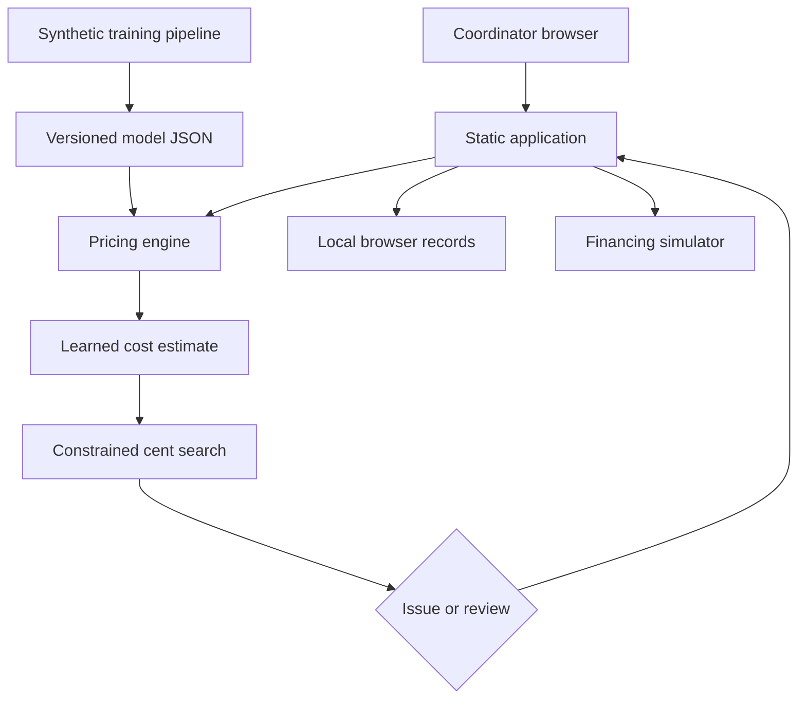
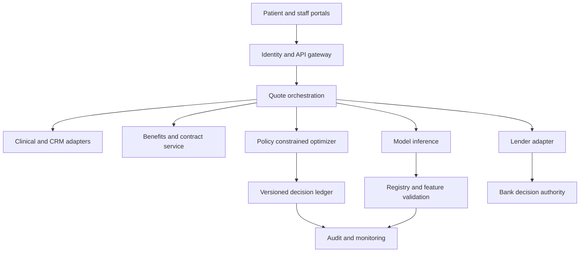

# Solution architecture

## Implemented prototype

Browser JavaScript loads the model artifact and runs inference locally. Price selection is exhaustive over the allowed integer-cent interval, with lexicographic tie-breaking. Contract examples are fictional constants. There is no backend, authenticated API, database or real partner connection. Local events and exports support demonstration, not trustworthy audit evidence.

## Target enterprise architecture — unimplemented

An orchestration service would bind approved treatment, contract snapshot, feature provenance, model version and policy version to each decision. Request keys, transaction boundaries and durable state transitions would prevent duplicate quotes and financing submissions. Corrections create new versions; accepted estimates require explicit adjustment workflows.

Zest AI would be a lender-approved integration only if supported by contractual and technical discovery. Synchrony is a proposed lender, not an implemented dependency. CRM is an engagement system; clinical records, contracts, model artifacts and financial decisions need separately authoritative sources.

## Decisions and tradeoffs

| Decision | Rationale | Limitation |
|---|---|---|
| Static app | Easy inspection, no secrets or service costs | Cannot enforce access or protect real records |
| Ridge model | Transparent coefficients and reproducibility | Synthetic linear generator favors this model |
| Exact cent search | Inspectable feasible optimum for small interval | Benchmark a scalable solver for larger baskets |
| Policy arithmetic outside ML | Reconciles exact balances and constraints | Policies require governed versioning |
| Simulated bank | Demonstrates workflow without vendor access | No qualification or real offers |

Production must address availability, isolation, audit integrity, retry semantics, signed policy approvals, model rollback, disaster recovery, accessibility and operational capacity. These have not been validated by the prototype.
