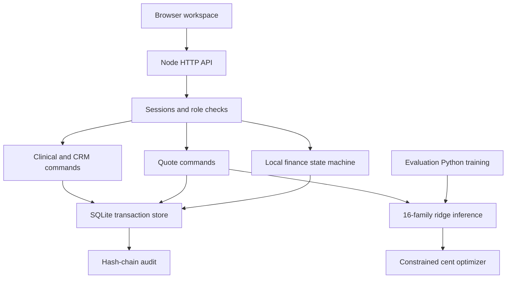

# Implemented solution architecture — release 3

The backend serves the UI and API from one origin. The hosted browser studio uses a local-storage adapter with the same `dist/pricing.mjs` estimator and treatment catalog. The embedded GrapesJS editor works with screen snapshots and exported layouts; canvas edits do not modify API behavior. Backend role, session and database protections apply to the Node application, while studio perspectives support walkthroughs. No CORS access is enabled. Passwords are scrypt-hashed; random session tokens are stored hashed in SQLite with an 8-hour lifetime. CSRF tokens and origin checks protect authenticated writes. Patient queries are scoped to their assigned evaluation patient ID.

Every command runs in a transaction with an actor-scoped idempotency key and payload hash. Reusing a key with a different command yields 409. Entity versions reject stale actions. Clinical plan approval is restricted to clinician; admin cannot approve. Issued prices remain fixed through acceptance and financing; only one estimate can be accepted per plan. Financing funds cannot exceed unpaid balance. Active financing must be withdrawn/refunded before plan cancellation.

SQLite entities persist patients, plans, quotes, finance applications and payment entries. Quote ledger values derive from payments and funded applications. Audit records are append-only through SQL triggers, linked by SHA-256. This is tamper-evident under ordinary application access; a privileged database owner can rewrite the database and chain. No cryptographic external anchoring is claimed.

The lender provider-event command is restricted to the local simulator and admin role; it is not a bank webhook or real integration. There are no live EHR, payer, external CRM, Synchrony or Zest adapters. This application is single-organization, single-instance and evaluation-only. Target enterprise scale, identity, data rights and real integrations remain in the completion matrix.

Legacy engine.mjs and model.json are retained for v1 regression evidence. The active server uses server/pricing.mjs and dist/cost-model.json. Legacy browser code is archived under demo/ and is not served.

Product and architecture direction: **Andrews Mensah**. [Project status](../PROJECT_STATUS.md).
